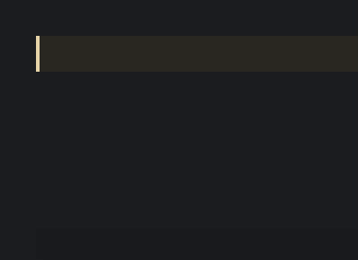
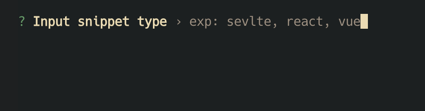
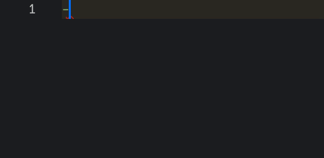

<p align="center">
  <a href="https://www.npmjs.com/package/csnp" target="_blank" rel="noopener noreferrer">
    
  </a>
</p>

<h1 align=center>csnp</h1>

<p align=center>A CLI tool for managing VSCode code snippets elegantly.</p>

<p align=center>
  <a href="https://www.npmjs.com/package/csnp">
    
  </a>
</p>

<p align="center">
  
</p>

## Introduction

**csnp** (Connect Snippets) helps you manage VSCode snippets using simple `.csnp` files. It bridges the gap between your snippet definitions and VSCode's configuration, allowing you to edit snippets in a clean, file-based format and sync them automatically.

## Installation

```bash
# via pnpm (recommended)
pnpm add -g csnp

# via npm
npm install -g csnp

# via yarn
yarn global add csnp

# via bun
bun add -g csnp
```

## Quick Start

1.  **Create a snippet**:
    Simply run `csnp` to start the interactive guide.

    ```bash
    csnp
    ```
    

2.  **Edit your snippet**:
    The command above will generate a `.csnp` file (e.g., `.csnp/js/log.csnp`). Open it and edit the content:

    ```csnp
    ---
    name: Log
    prefix: '-log'
    description: log something
    ---

    console.log($1)
    ```

3.  **Push to VSCode**:
    Apply your changes to VSCode.

    ```bash
    csnp push
    ```

4.  **Use it**:
    Open a JavaScript file in VSCode, type `-log`, and press Enter!

    

## Commands

### `push`
Commit your code snippets into VSCode.

```bash
# Push to Local scope (.vscode/ folder in current project)
csnp push

# Push to Global scope (VSCode User Snippets)
csnp push -G
```

### `pull`
Sync snippets from VSCode configuration back to your `.csnp` files. Useful for editing existing snippets.

```bash
# Pull from Local scope
csnp pull

# Pull from Global scope
csnp pull -G
```

### `list` / `ls`
List all stored code snippets files.

```bash
csnp ls
```

### `preview` / `pv`
Preview the parsed content of your snippets in the terminal.

```bash
csnp pv
```

### Help & Version

```bash
# Display help message
csnp -H

# Display version number
csnp -V
```

## File Structure

The standard path for a snippet file is:
`.csnp/{SnippetType}/{SnippetName}.csnp`

```text
.vscode/                   # VSCode configuration directory
└── .csnp/                 # CSNP storage directory
    ├── js/                # [SnippetType] Language ID (e.g. javascript)
    │   ├── log.csnp       # [SnippetName] Snippet definition file
    │   └── util.csnp
    ├── ts/
    │   └── interface.csnp
    └── vue/
        └── component.csnp
```

*   **SnippetType**: The language ID (e.g., `js`, `ts`, `vue`, `react`, `python`).
*   **SnippetName**: The filename for your snippet.

**Example**: `.csnp/js/log.csnp`

Inside the file, use YAML frontmatter for metadata and the body for the code:

```markdown
---
name: Log
prefix: '-log'
description: A console log snippet
scope: javascript,typescript
---

console.log('Hello CSNP!')
```

## Scope

CSNP supports two scopes for storing snippets:

*   **Local (Default)**: Stored in `.vscode/` of your current project. Best for project-specific snippets.
*   **Global (`-G`)**: Stored in VSCode's user data directory. Best for general-purpose snippets available in all projects.

## Links

*   [VSCode Snippets Documentation](https://code.visualstudio.com/docs/editor/userdefinedsnippets)

## License

MIT © Junxio
